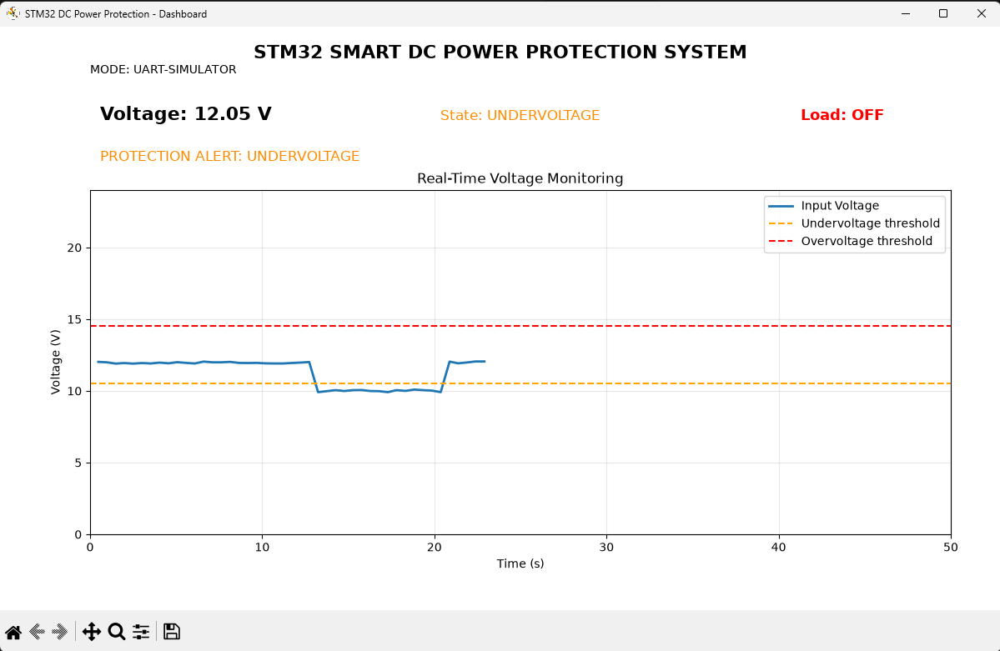

# STM32 Smart DC Power Protection System

[](https://github.com/Anass-AitYakoub/STM32-DC-Power-Protection/actions/workflows/embedded-tests.yml)

**STM32 | Embedded C | Python | UART | ADC | Electrical Protection | GitHub Actions**

An embedded DC power monitoring and protection system designed around the STM32 NUCLEO-F401RE microcontroller.

The project monitors a nominal 12 V DC supply, detects abnormal voltage conditions, manages fault states, and provides monitoring through a Python dashboard.

It combines embedded firmware development, electrical engineering, signal processing, software testing, and real-time data visualization.

> **Project Status:** Firmware implementation and software simulation completed. Hardware integration and electrical validation are pending.

---

## 1. Project Objectives

The main objectives of this project are to:

- Monitor a DC power supply using STM32 ADC measurements.
- Detect undervoltage, overvoltage, and critical faults.
- Implement a fault-latching protection state machine.
- Control the logical enable/disable decision for an external electrical load.
- Filter voltage measurements using a digital EMA filter.
- Support manual fault reset with button debouncing.
- Transmit system telemetry using UART.
- Visualize measurements and protection states using Python.
- Validate protection algorithms using automated tests and GitHub Actions.

The physical MOSFET switching stage will be enabled only after hardware safety validation.

---

## 2. System Architecture

```text
                 DC INPUT (12 V)
                       |
                       v
                Voltage Divider
                       |
                       v
               STM32 ADC1 (PA0)
                       |
                       v
              ADC Voltage Conversion
                       |
             +---------+---------+
             |                   |
             v                   v
      Raw Voltage Check      EMA Filter
             |                   |
             v                   v
      Critical Fault       Timed Protection
         Detection           State Machine
             |                   |
             +---------+---------+
                       |
                       v
                Load Permission
                       |
                       v
               MOSFET Controller
              (Hardware Pending)

                       |
                       v
                 UART USART2
                       |
                       v
              Python Monitoring
                  Dashboard
                       |
                       v
                  CSV Logging
```

The embedded firmware separates voltage acquisition, protection decisions, communication, and hardware control into independent modules.

---

## 3. Protection Features

### Voltage Protection

The system implements the following provisional thresholds:

| Parameter | Value |
|---|---|
| Nominal input voltage | 12 V DC |
| Undervoltage threshold | 10.5 V |
| Overvoltage threshold | 14.5 V |
| Critical undervoltage | 9.0 V |
| Critical overvoltage | 16.0 V |
| Ordinary fault confirmation | 100 ms |
| Startup validation | 100 ms |
| Nominal sampling period | 10 ms |
| ADC resolution | 12 bits |
| UART baud rate | 115200 |

Thresholds are currently software-development parameters and must be validated against the electrical load and hardware design.

### Protection State Machine

The firmware defines six protection states:

- `STARTUP`: Load disabled during initial validation.
- `NORMAL`: Voltage is acceptable and logical load operation can be permitted.
- `UNDERVOLTAGE`: Confirmed low-voltage fault.
- `OVERVOLTAGE`: Confirmed high-voltage fault.
- `SENSOR_FAULT`: Invalid voltage measurement.
- `CRITICAL_FAULT`: Critical voltage or ADC fault requiring a latched shutdown.

Ordinary faults require confirmation, while critical faults trigger an immediate software shutdown decision upon detection.

A manual reset is required to recover from latched faults. The system must pass startup validation again before restoring logical load permission.

### Digital Filtering

An Exponential Moving Average (EMA) filter reduces measurement noise:

V_filtered = alpha * V_new + (1 - alpha) * V_previous

The initial filter coefficient is:

alpha = 0.2

Critical fault detection uses raw voltage measurements to avoid delays introduced by filtering.

---

## 4. Hardware Platform

### Microcontroller

**STMicroelectronics NUCLEO-F401RE**

The firmware is designed for the STM32F401RE ARM Cortex-M4 microcontroller.

### Planned Hardware

| Component | Purpose |
|---|---|
| STM32 NUCLEO-F401RE | Embedded processing and ADC |
| FQP27P06 P-channel MOSFET | High-side load switching |
| PN2222A transistor | MOSFET gate driver |
| Voltage divider | Scaling DC input for the ADC |
| 12 V Zener diode | MOSFET gate protection |
| 100 ohm power resistor | Test load |
| LEDs | Status indication |
| User pushbutton | Manual fault reset |
| DC power supply | Adjustable test input |
| Fuse and wiring protection | Hardware fault protection |

The system is intended to use a modular breadboard-based development setup.

High-current connections and power components will be handled with suitable wiring and connectors rather than through breadboard power rails.

The final wiring, ADC protection network, MOSFET gate-drive circuit, and electrical safety requirements remain subject to hardware validation.

---

## 5. Embedded Firmware

The firmware is written in C and organized into independent modules.

| Module | Responsibility |
|---|---|
| `main.c` | Main firmware execution |
| `adc_reader.c` | STM32 ADC acquisition |
| `voltage_monitor.c` | ADC conversion and EMA filtering |
| `critical_fault.c` | Critical voltage and ADC fault detection |
| `protection.c` | Protection state machine |
| `load_control.c` | Logical load switching |
| `hardware_io.c` | Logical hardware interface |
| `board_led.c` | Onboard LED GPIO |
| `reset_button.c` | User button and debouncing |
| `system_timer.c` | SysTick timing |
| `uart_comm.c` | USART2 communication |
| `telemetry.c` | Serial message formatting |

The firmware is built using CMake and the ARM embedded toolchain.

Successful compilation has been verified. Physical execution and timing accuracy still require testing on the NUCLEO-F401RE.

---

## 6. UART Communication Protocol

The STM32 telemetry format uses comma-separated ASCII messages:

```text
DATA,<voltage>,<state>,<load>,<critical_fault>
```

Example messages:

```text
DATA,12.04,NORMAL,OFF,NONE
DATA,10.12,UNDERVOLTAGE,OFF,NONE
DATA,17.10,CRITICAL_FAULT,OFF,OVERVOLTAGE
```

The Python serial protocol validates:

- Message structure
- Voltage format and range
- Protection state
- Load status
- Critical fault type

During firmware diagnostics, telemetry reports the physical load as OFF.

Real STM32-to-PC telemetry transmission has not yet been validated on hardware.

---

## 7. Python Monitoring Dashboard

### Dashboard Preview



*Python monitoring dashboard running in UART simulation mode. Hardware integration and validation are pending.*

The Python dashboard provides:

- Real-time voltage visualization
- Protection state monitoring
- Load status indication
- Undervoltage and overvoltage indicators
- Critical fault alerts
- CSV measurement logging
- Simulation and serial communication modes

The application is developed using Python, Matplotlib, and PySerial.

### Operating Modes

| Mode | Description |
|---|---|
| `simulation` | Generates simulated voltage and fault scenarios |
| `uart-simulator` | Generates and parses simulated UART telemetry |
| `serial` | Receives telemetry through a serial COM port |

### Installation

Install Python dependencies:

```bash
python -m pip install -r python/requirements.txt
```

### Run Simulation Mode

```bash
python python/dashboard.py --mode simulation
```

### Run UART Simulator Mode

```bash
python python/dashboard.py --mode uart-simulator
```

### Run Real Serial Mode

```bash
python python/dashboard.py --mode serial --port COM4
```

Replace `COM4` with the actual port assigned to the STM32.

Real serial mode requires a connected and correctly programmed STM32.

### CSV Logging

Dashboard measurements are recorded in the `logs/` directory.

Each CSV record contains:

```text
timestamp,voltage,protection_state,load_status,critical_fault
```

This allows recorded voltage events to be reviewed and analyzed.

---

## 8. Automated Testing

Automated unit tests are implemented for both Embedded C and Python.

### Embedded C Tests

The C unit tests cover:

- Safe startup
- Normal voltage operation
- Undervoltage detection
- Overvoltage detection
- Transient fault rejection
- Critical undervoltage
- Critical overvoltage
- ADC conversion failure
- Fault latching
- Manual reset and recovery

### Python Tests

The Python tests cover:

- Valid telemetry parsing
- Critical fault messages
- Invalid prefixes
- Invalid voltages
- Invalid protection states
- Invalid load status
- Invalid fault types
- Missing message fields
- Out-of-range voltages
- UART simulator output

### GitHub Actions

The repository includes a GitHub Actions CI workflow that automatically compiles and executes the host-based C tests and Python protocol tests.

**Latest verified CI result: Both jobs passed.**

This validation covers the tested software logic, not the electrical hardware or full firmware execution on the STM32.

### Run Python Tests

```bash
python -m unittest discover -s tests -p "test_*.py" -v
```

---

## 9. Repository Structure

```text
STM32_DC_Power_Protection/
|
+-- .github/
|   +-- workflows/
|       +-- embedded-tests.yml
|
+-- Inc/
|   +-- Firmware header files
|
+-- Src/
|   +-- Firmware C source files
|
+-- python/
|   +-- dashboard.py
|   +-- serial_protocol.py
|   +-- serial_reader.py
|   +-- uart_simulator.py
|   +-- requirements.txt
|
+-- tests/
|   +-- test_protection.c
|   +-- test_protection_timed.c
|   +-- test_serial_protocol.py
|
+-- CMakeLists.txt
+-- CMakePresets.json
+-- README.md
```

---

## 10. Project Development Status

| Development Stage | Status |
|---|---|
| Embedded firmware architecture | Completed |
| Voltage conversion and EMA filtering | Implemented |
| Protection state machine | Implemented |
| Critical fault detection | Implemented |
| UART communication firmware | Compiled |
| Python monitoring dashboard | Working in simulation |
| UART telemetry simulator | Working |
| C and Python automated CI tests | Passing |
| STM32 hardware programming | Pending |
| ADC calibration and validation | Pending |
| MOSFET switching validation | Pending |
| Complete system testing | Pending |

---

## 11. Planned Hardware Validation

The next development stages include:

1. Program the STM32 NUCLEO-F401RE.
2. Verify the system clock, SysTick timing, and UART configuration.
3. Validate ADC measurements using known safe voltages.
4. Test UART telemetry with the Python dashboard.
5. Validate the voltage sensing and protection circuitry.
6. Test MOSFET switching with a suitable low-voltage load.
7. Measure real fault detection and shutdown response times.
8. Verify startup, reset, fault latching, and power-loss behavior.
9. Compare measured electrical behavior with software expectations.

Hardware protection must be verified before connecting the complete 12 V test circuit.

---

## 12. Engineering Skills Demonstrated

**Embedded Systems**
- STM32 firmware development
- Embedded C programming
- GPIO, ADC, UART, and SysTick configuration
- Finite state machines
- Timing and fault handling

**Electrical Engineering**
- DC voltage monitoring
- Voltage dividers
- MOSFET switching concepts
- Power protection architecture
- Digital filtering

**Software Engineering**
- Modular firmware architecture
- Python development
- Serial communication protocols
- Automated unit testing
- Git and GitHub
- Continuous Integration

**Data Monitoring**
- Real-time visualization
- Fault alerts
- CSV data acquisition
- Simulation and diagnostic tools

---

## Author

**Anass Ait Yakoub**

Electrical Engineering Student  
Concordia University

[GitHub Profile](https://github.com/Anass-AitYakoub)

---

*This project is intended for educational development and engineering portfolio demonstration. It is not a certified electrical protection device.*
